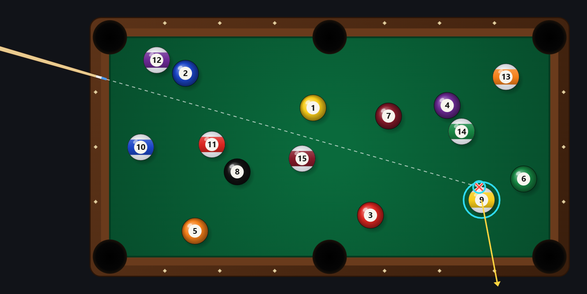
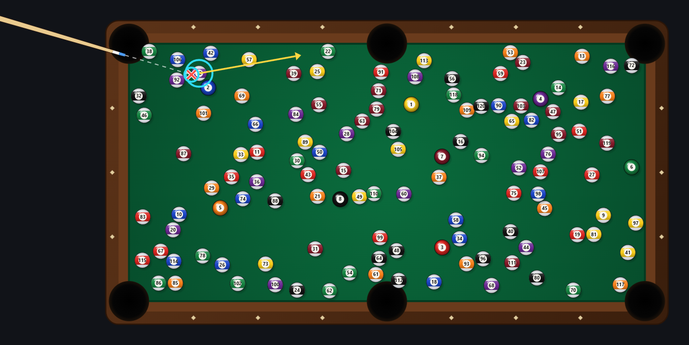
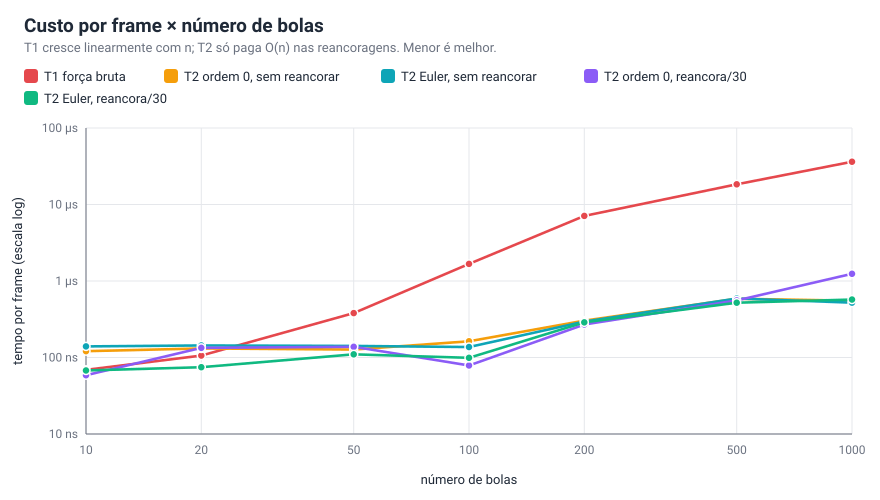
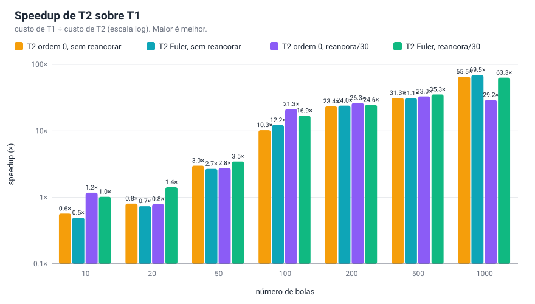
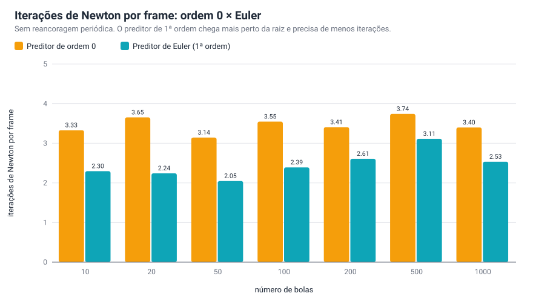
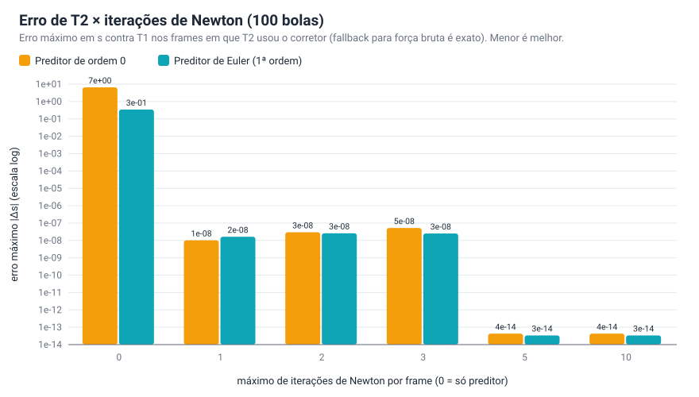
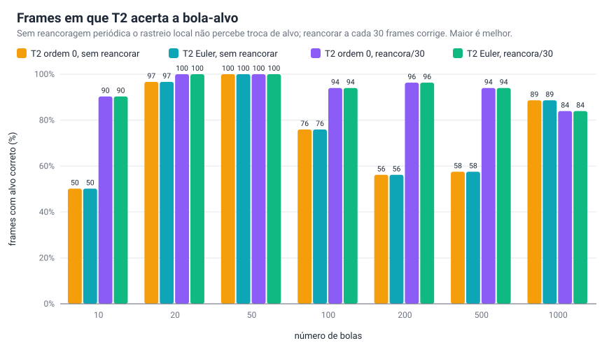

# Simulação otimizada de pontos de contato em uma mesa de bilhar 2D

Trabalho de Programação de Algoritmos Numéricos em Tempo Real.

Implementa e compara dois algoritmos para encontrar o **ponto de contato**
entre a reta do taco e as bolas de uma mesa de bilhar 2D:

- **Algoritmo 1 — força bruta (T1)**: testa a reta contra todas as bolas a
  cada frame e retorna o contato mais próximo do taco.
- **Algoritmo 2 — rastreamento preditor + corretor (T2)**: mantém o contato
  encontrado e o atualiza incrementalmente, frame a frame — sem reprocessar
  todas as bolas. Um **preditor** chuta o novo valor (ordem 0: reaproveita o
  frame anterior; 1ª ordem: passo de Euler numa EDO derivada do vínculo
  geométrico) e um **corretor de Newton** refina até convergir. A cada `N`
  frames reancora por força bruta (Melhoria 1).

## Integrantes

| Nome | Matrícula |
|------|-----------|
| Thiago Dutra Rodrigues Paixão | 2020.1.00765-11 |
| Guilherme Alves Freire | 2023.1.00512-11 |
| Victor Hugo Boaventura Pinheiro Alves | 2017.1.02795-11 |

## O problema

A mesa é um retângulo `[0, largura] x [0, altura]` com bolas circulares.
O taco define, a cada instante `t`, uma reta

```
X(s, t) = P(t) + s · d(t),   s ≥ 0
```

onde `P(t)` é a ponta do taco e `d(t)` a direção (unitária) da mirada.
Cada bola `i` tem centro `Cⁱ(t)` e raio `rⁱ` (possivelmente em movimento).
O **ponto de contato** é a interseção de `X(s,t)` com a bola mais próxima do
taco, isto é, o menor `s ≥ 0` tal que

```
|P(t) + s d(t) − Cⁱ(t)|² = (rⁱ)²
```

para alguma bola `i`.

## Algoritmo 1 — força bruta (T1)

Para cada bola, a equação acima é uma quadrática em `s`:

```
s² + 2(V·d) s + (V·V − r²) = 0,   V = P − C
```

(`d` é unitário, então o coeficiente de `s²` é 1). Resolvendo por Bhaskara,
ficamos com até duas raízes; a menor, `s₁`, é onde a reta *entra* na bola
(se `s₁ < 0`, a ponta do taco está dentro da bola ou a bola está atrás dela, e
ela é ignorada). Repetindo para as `n` bolas e tomando o menor `s` entre elas,
obtemos o contato mais próximo do taco.

**Custo:** `O(n)` interseções reta-círculo por frame — refeito do zero
sempre, mesmo que o taco e as bolas tenham se movido muito pouco entre um
frame e o outro. Ver [`brute_force_contact`](src/BilharSim.jl).

## Algoritmo 2 — rastreamento preditor + corretor (T2)

A ideia é não jogar fora a informação do frame anterior. Para a bola já
travada (`ball_index`) o contato é a raiz de

```
F(s, t) = |P(t) + s d(t) − C(t)|² − r² = 0
```

e, de um frame para o outro, a raiz `s` muda pouco. O T2 mantém `s` com um
esquema **preditor–corretor**:

**1. Preditor** — chuta `s_pred` para o frame novo:

- **Ordem 0** (`predictor = :order0`): `s_pred = s` (reaproveita o valor do
  frame anterior, sem usar nenhuma informação de movimento).
- **1ª ordem / Euler** (`predictor = :euler`): `s_pred = s + s′ · dt`, onde
  `s′` vem da EDO obtida diferenciando `F(s,t) = 0` implicitamente em `t`:

```
V := P + s d − C
2 V · (P′ + s d′ − C′ + s′ d) = 0     (r constante)

        −V · (P′ + s d′ − C′)
  s′ =  ------------------------
                V · d
```

  com `P′, d′` por diferença finita entre frames e `C′` = velocidade real da
  bola (conhecida exatamente na simulação). `V` é avaliado no estado do
  frame **anterior** (inclusive o centro anterior da bola, `C − C′·dt`).

**2. Corretor de Newton** — itera sobre `F(s) = 0` já com `P, d, C` do frame
novo:

```
s ← s − F(s)/F′(s),      F′(s) = 2 V·d
```

até `|Δs| < newton_tol` ou `newton_iters` iterações. Como a convergência é
quadrática, o erro que sobra após a parada é da ordem de `newton_tol²`.
Quanto melhor o preditor, menos iterações: o de Euler já começa muito mais
perto da raiz que o de ordem 0. Com `newton_iters = 0` só o preditor age
(sem corretor), o que mostra a deriva de cada um: no cenário de teste o erro
máximo é ≈4,6 para ordem 0 e ≈0,065 para Euler, contra ≈1e-14 com Newton.

**3. Falhas e reancoragem.** O corretor é descartado se não converge, se a
reta está quase tangente (`F′ ≈ 0`), ou se cai na raiz de saída da bola
(`V·d ≥ 0`). Nesses casos, e a cada `recompute_every` frames, o rastreador
**reancora** com uma chamada de força bruta (T1). Isso é necessário porque o
rastreio local só olha a bola travada: ele não percebe sozinho que *outra*
bola passou a ser a mais próxima (troca de alvo). Essa é a **Melhoria 1**
do enunciado; `recompute_every = 0` desliga a reancoragem periódica.

**Custo:** `O(1)` por frame quando o rastreio funciona (uma predição + 2 a 4
iterações de Newton, todas sobre uma única bola), pagando `O(n)` só nas
reancoragens. Ver [`step_tracker!`](src/BilharSim.jl).

## Estrutura do projeto

```
src/BilharSim.jl     núcleo: Ball, Table, física das bolas, algoritmo 1 e algoritmo 2
src/Server.jl        backend web (HTTP.jl): guarda a simulação e roda T1/T2 a cada frame
web/                 frontend no navegador: index.html, style.css, app.js (canvas)
scripts/run_server.jl  sobe o servidor e abre o navegador
scripts/benchmark.jl   benchmarks T1 x T2; gera CSVs, gráficos SVG e relatório em docs/benchmark/
scripts/report.jl      gerador dos gráficos SVG e do relatório HTML (usado pelo benchmark)
test/runtests.jl     testes: geometria, preditores, Newton, troca de alvo, servidor
docs/                roteiro da apresentação e capturas de tela
```

Arquitetura: **backend em Julia** (todos os algoritmos e a física das bolas)
e **frontend no navegador** (só desenha e envia a posição do taco e os
controles). A cada frame a página faz um `POST /api/tick` e o servidor
responde com as bolas, os contatos do T1 e do T2 e os tempos medidos em
Julia.

## Como rodar

Requer Julia ≥ 1.10 (testado em 1.12) e um navegador qualquer. Não precisa
de placa de vídeo nem de janela gráfica do Julia.

```bash
# na raiz do projeto
julia --project=. -e "using Pkg; Pkg.instantiate()"   # primeira vez: instala HTTP e JSON3

julia --project=. scripts/run_server.jl                # sobe o servidor e abre http://localhost:8080
julia --project=. test/runtests.jl                     # roda os testes
julia --project=. scripts/benchmark.jl                 # roda o benchmark T1 x T2
```

Para usar outra porta: `julia --project=. scripts/run_server.jl 9000`.
Se o navegador não abrir sozinho, acesse o endereço impresso no terminal.
Para parar, `Ctrl+C` no terminal.

## Visualização



A mesa tem feltro, caçapas e bolas numeradas que se movem, quicam nas
bordas e colidem entre si. O taco anda sozinho (modo automático) ou você
**arrasta o mouse** (ou o dedo) na mesa: o clique define a ponta `P` do
taco e a posição do ponteiro define a direção `d`.

- **× vermelho** = contato calculado pelo T1 (força bruta) a cada frame.
  **Círculo ciano** = contato rastreado pelo T2, com um anel ciano na bola
  que o T2 está seguindo. Se T1 e T2 discordam sobre qual é a bola alvo (o
  T2 ainda não reancorou), aparece um anel vermelho tracejado na bola
  correta.
- A linha **amarela** sai do centro da bola atingida na direção da força
  de impacto (do ponto de contato ao centro).
- Painel à direita: troca entre preditor de ordem 0 e de Euler, máximo de
  iterações de Newton (0 = só preditor), período de reancoragem (Melhoria
  1), número e raio das bolas, pausa, taco automático e botão de embaralhar.
- **Medidas** ao vivo: tempo de T1 e T2 (medidos em Julia), *speedup*, erro
  de `s` contra T1, iterações de Newton por frame e % de frames recentes em
  força bruta; dois gráficos mostram o erro (escala log; ponto vermelho =
  T2 na bola errada, triângulo amarelo = reancoragem) e o tempo por frame.

Com poucas bolas o ganho é pequeno (T1 já é barato); aumente o número de
bolas para ver o T2 abrir vantagem:



## Resultados

`scripts/benchmark.jl` roda dois experimentos e gera tabelas, CSVs, gráficos
SVG e um **relatório HTML** em [`docs/benchmark/`](docs/benchmark/)
(abra [`docs/benchmark/relatorio.html`](docs/benchmark/relatorio.html) no
navegador). Todas as configurações veem exatamente a mesma sequência de 300
frames (taco girando, bolas em movimento, densidade constante de bolas); o
tempo é o mínimo de 40 passadas, com a coleta de lixo desligada durante a
medição, e T1 e T2 são implementados sem alocação por bola.

```bash
julia --project=. scripts/benchmark.jl      # ~2 min; regrava docs/benchmark/
```

### A) Custo por frame × número de bolas

Execução de referência (Julia 1.12.7, Intel Core i5-12450HX, Windows). Entre
parênteses, o *speedup* sobre o T1:

| bolas | T1 (tempo/frame) | ordem 0, sem reancorar | Euler, sem reancorar | ordem 0, reancora/30 | Euler, reancora/30 |
|---:|---:|---:|---:|---:|---:|
| 10 | 69 ns | 121 ns (**0,6×**) | 140 ns (**0,5×**) | 59 ns (**1,2×**) | 68 ns (**1,0×**) |
| 20 | 106 ns | 131 ns (**0,8×**) | 144 ns (**0,7×**) | 134 ns (**0,8×**) | 75 ns (**1,4×**) |
| 50 | 381 ns | 127 ns (**3,0×**) | 142 ns (**2,7×**) | 138 ns (**2,8×**) | 110 ns (**3,5×**) |
| 100 | 1,7 µs | 163 ns (**10,3×**) | 137 ns (**12,2×**) | 79 ns (**21,3×**) | 99 ns (**16,9×**) |
| 200 | 7,1 µs | 303 ns (**23,4×**) | 295 ns (**24,0×**) | 270 ns (**26,3×**) | 288 ns (**24,6×**) |
| 500 | 18,4 µs | 586 ns (**31,3×**) | 590 ns (**31,1×**) | 557 ns (**33,0×**) | 520 ns (**35,3×**) |
| 1000 | 36,2 µs | 553 ns (**65,5×**) | 521 ns (**69,5×**) | 1,2 µs (**29,2×**) | 572 ns (**63,3×**) |





- **O ganho do T2 cresce com o número de bolas**: T1 custa uma interseção
  reta-círculo por bola por frame (~7–36 ns por bola). O custo base do T2 é
  quase constante (~100–150 ns: preditor + 2 a 4 iterações de Newton numa só
  bola) mais o custo dos *fallbacks*: cada reancoragem paga um T1 inteiro,
  diluído nos 300 frames (ex.: 11 fallbacks × 18 µs ÷ 300 ≈ 0,65 µs com 500
  bolas, o que explica T2 ≈ 0,55 µs ali em vez de ~0,15 µs).
- **Ponto de equilíbrio**: com 10–20 bolas o T1 já é tão barato que o T2 não
  compensa (speedup ≈ 1 ou menor); a partir de ~50 bolas o T2 ganha, e com
  100–1000 bolas o ganho é de ~10× a ~65×.
- **Ruído**: abaixo de ~100 ns por frame a medição varia dezenas de ns de uma
  execução para outra, então diferenças entre as colunas de T2 com poucas
  bolas estão dentro do ruído (ex.: com 1000 bolas, "ordem 0 reancora/30"
  saiu a 1,2 µs numa execução e a ~0,55 µs nas outras). Os contadores
  (fallbacks, iterações de Newton, erro, acerto do alvo) são determinísticos.
- **Precisão**: nos frames em que T2 e T1 apontam a mesma bola, a diferença
  em `s` é < 3e-11 em todas as configurações.

### B) Qualidade do preditor e iterações de Newton

Iterações de Newton por frame (máximo de 10, convergência até `|Δs| < 1e-8`),
sem reancoragem periódica:

| bolas | Newton/frame, ordem 0 | Newton/frame, Euler |
|---:|---:|---:|
| 10 | 3,33 | 2,29 |
| 20 | 3,65 | 2,24 |
| 50 | 3,14 | 2,05 |
| 100 | 3,54 | 2,39 |
| 200 | 3,41 | 2,61 |
| 500 | 3,74 | 3,11 |
| 1000 | 3,40 | 2,53 |



O preditor de 1ª ordem (Euler) chega mais perto da raiz e economiza ~1
iteração de Newton por frame. Em tempo de relógio isso não aparece (cada
iteração custa poucos ns e a EDO do Euler também custa); a vantagem fica
clara olhando o erro quando se limita o número de iterações (100 bolas):

| preditor | iterações de Newton | erro máx \|Δs\| | frames que caíram em força bruta (de 299) |
|---|---:|---:|---:|
| ordem 0 | 0 (só preditor) | 6,5 | 0 |
| Euler | 0 (só preditor) | 0,34 | 0 |
| ordem 0 | 1 | 1,0e-8 | 297 |
| Euler | 1 | 1,6e-8 | 90 |
| ordem 0 | 2 | 3,0e-8 | 54 |
| Euler | 2 | 2,6e-8 | 5 |
| ordem 0 | 5 ou 10 | 4,3e-14 | 2 |
| Euler | 5 ou 10 | 3,4e-14 | 2 |



- Só com o preditor (sem corretor), o erro do ordem 0 é ~20× o do Euler.
- Com poucas iterações, o corretor ainda não passa no teste de resíduo e o T2
  cai em força bruta (que é exata): isso acontece em quase todos os frames com
  o ordem 0 (297 de 299 com 1 iteração) e em bem menos com o Euler (90 de 299).
  Por isso, com iterações limitadas, o Euler é muito mais barato.
- A partir de 5 iterações os dois chegam à raiz com erro ~1e-14.

### C) Acerto da bola-alvo e Melhoria 1



| bolas | alvo correto, sem reancorar | alvo correto, reancora/30 |
|---:|---:|---:|
| 10 | 50,2% | 90,3% |
| 20 | 96,7% | 100,0% |
| 50 | 100,0% | 100,0% |
| 100 | 75,9% | 94,0% |
| 200 | 56,2% | 96,3% |
| 500 | 57,5% | 94,0% |
| 1000 | 88,6% | 83,9% |

O rastreio local só segue a bola travada e não percebe que outra bola passou
a ser a mais próxima; sem reancorar ele só se corrige quando o corretor falha.
Reancorar a cada 30 frames (Melhoria 1) eleva o acerto para ~90–100% na
maioria dos casos, ao custo de algumas chamadas de força bruta. A exceção é
a mesa com 1000 bolas (88,6% sem reancorar contra 83,9% com), onde a bola
mais próxima muda tantas vezes por segundo que o período de 30 frames é
longo demais; não investiguei esse caso a fundo.

## Limitações e possíveis extensões

- A física das bolas (movimento, quique nas bordas, colisão elástica entre
  bolas de mesma massa) existe só para dar vida à demonstração; o foco do
  trabalho é o ponto de contato do taco, não a dinâmica completa do jogo.
- Perto da tangência (reta raspando a bola) `F′ ≈ 0` e o Newton converge
  devagar; o rastreador então só aceita resíduos muito pequenos e, caso
  contrário, reancora por força bruta.
- O preditor de Euler usa diferenças finitas para `P′` e `d′`; um preditor
  de ordem maior (p. ex. extrapolação com dois frames anteriores) é uma
  extensão natural.
- `recompute_every` é fixo; uma extensão é torná-lo adaptativo (reancorar
  sob demanda quando a distância ao alvo atual estiver próxima da de outra
  bola).
